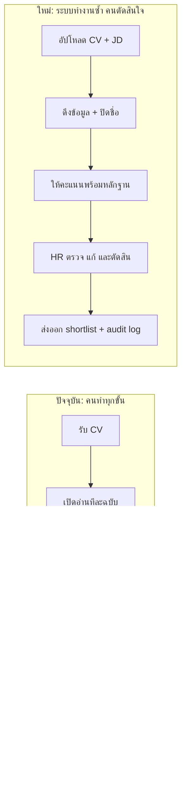
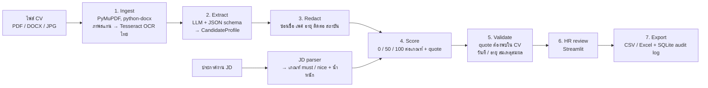

# TalentLens: Document Intelligence สำหรับคัดกรองใบสมัครงาน

[](https://colab.research.google.com/github/thassanunsat-art/Pearson-TalentLens/blob/main/notebooks/TalentLens_Colab.ipynb)

TalentLens อ่าน CV (PDF, Word, ภาพสแกน ทั้งไทยและอังกฤษ) ดึงข้อมูลผู้สมัครออกมาเป็นโครงสร้าง
ให้คะแนนเทียบกับประกาศรับสมัครงาน (JD) **พร้อมประโยคหลักฐานที่ตรวจแล้วว่ามีอยู่ใน CV จริง**
แล้วจัดอันดับให้ฝ่ายบุคคลตัดสิน โดยคนยังเป็นผู้ตัดสินสุดท้ายเสมอ

> งานกลุ่มรายวิชา Document Intelligence · โดเมน: งานสรรหาบุคลากร (HR Recruitment)
> เอกสารออกแบบฉบับเต็ม: *(ใส่ลิงก์เอกสารออกแบบของกลุ่ม)* · วิดีโอนำเสนอ: *(ใส่ลิงก์ YouTube)*

## ปัญหา

การคัดกรอง CV รอบแรกทำด้วยมือทั้งหมด จึง **ช้า** (อ่านทีละฉบับ รูปแบบไม่เหมือนกัน บางฉบับเป็นภาพสแกน)
**ไม่สม่ำเสมอ** (แต่ละคนใช้เกณฑ์ต่างกัน) **พลาดคนที่เหมาะ** (จับคำตรงตัว เช่น CV เขียน "pandas" แต่ JD เขียน "Python")
**ตรวจย้อนหลังไม่ได้** (ไม่บันทึกเหตุผล) และ **มีอคติ** (เห็นชื่อ เพศ อายุ ก่อนเห็นทักษะ)

## กระบวนการ



## สถาปัตยกรรม



ขั้น Extract และ Score เลือก "สมอง" ได้ 3 แบบ ส่วนขั้นอื่นใช้ร่วมกัน

| วิธี | อ่านภาพสแกน | เข้าใจคำพ้องความหมาย | ค่าใช้จ่าย |
| --- | --- | --- | --- |
| **Rule-based** (regex + พจนานุกรมทักษะ) | ผ่าน Tesseract OCR | ไม่ได้ | ฟรี |
| **โมเดล open-source** ผ่าน [Ollama](https://ollama.com) (ค่าเริ่มต้น `qwen2.5:7b`) | ผ่าน Tesseract OCR | ได้ | ฟรี (รันบนเครื่องหรือ GPU ฟรีของ Colab) |
| **Claude API** (ไม่บังคับ) | อ่านภาพได้เอง | ได้ | ตามจำนวน token |

หลักการออกแบบที่สำคัญ

- **LLM ตัดสินรายเกณฑ์ ส่วนโค้ดคำนวณคะแนนรวม**: `คะแนนรวม = Σ(น้ำหนัก × คะแนนเกณฑ์) / Σ น้ำหนัก` ได้ผลคงที่และตรวจสอบได้
- **กันโมเดลแต่งข้อมูล (hallucination)**: ทุก quote ถูกตรวจด้วย fuzzy match กับข้อความ CV ถ้าไม่พบ คะแนนเกณฑ์นั้นเป็น 0 และติดธง
- **Blind screening**: โมเดลที่ให้คะแนนเห็นเฉพาะข้อความที่ปิดข้อมูลระบุตัวตนแล้ว
- **รองรับเอกสารไทยจริง**: แปลงปี พ.ศ. แก้สระอำที่แตก (`ํา` → `ำ`) และตรวจ text layer ที่เพี้ยนจากฟอนต์ไทย แล้วส่งเป็นภาพแทน
- **โมเดลในเครื่องถูกบังคับรูปแบบคำตอบ**: ส่ง JSON schema ให้ Ollama (constrained decoding), ตั้ง temperature 0
  และขยาย context เป็น 8192 token เพราะข้อความภาษาไทยใช้ token มาก ถ้าคำตอบไม่ผ่าน schema จะส่งข้อผิดพลาดกลับให้แก้ 1 รอบ

## วิธีรัน

**ง่ายที่สุด: Google Colab (ฟรี)** กดปุ่ม *Open in Colab* ด้านบน เลือก *Runtime → T4 GPU* แล้วรันทีละช่อง
notebook จะติดตั้ง Tesseract, Ollama และโมเดลให้ แล้วรันการประเมินผลทั้ง 3 แนวทาง

**บนเครื่องตัวเอง**

```bash
python -m venv .venv
# Windows: .venv\Scripts\activate    macOS/Linux: source .venv/bin/activate
pip install -r requirements.txt
# OCR ภาษาไทย: Ubuntu `sudo apt install tesseract-ocr tesseract-ocr-tha`
#              Windows: ติดตั้ง Tesseract (UB Mannheim) และเลือกภาษา Thai
# โมเดล open-source: ติดตั้ง Ollama จาก ollama.com แล้ว
ollama pull qwen2.5:7b
streamlit run app.py
```

ถ้าต้องการลอง Claude API ด้วย (ไม่บังคับ) ให้ `cp .env.example .env` แล้วใส่ `ANTHROPIC_API_KEY`

> **Windows:** ถ้า `pip install anthropic` ล้มเหลวเพราะ path ยาวเกิน ให้สร้าง venv ในโฟลเดอร์ที่ path สั้น
> (เช่น `C:\venvs\talentlens`) หรือเปิด Long Paths ใน Windows

ในแอป: เลือกตำแหน่งตัวอย่าง (หรือวาง JD เอง) → ปรับเกณฑ์และน้ำหนัก → อัปโหลด CV หรือใช้ CV ตัวอย่าง →
กด **คัดกรอง** → ดูอันดับ หลักฐาน และข้อควรตรวจ → บันทึกการตัดสิน → ดาวน์โหลด CSV/Excel

ตั้งค่าได้ด้วย environment variables: `TALENTLENS_LOCAL_MODEL` (โมเดล Ollama), `OLLAMA_HOST`,
`TALENTLENS_MODEL` / `TALENTLENS_EFFORT` (Claude; ค่าเริ่มต้น `claude-opus-5-5` ที่ effort `medium`
พร้อม server-side fallback เมื่อโมเดลปฏิเสธคำขอ)

## ชุดข้อมูลและการประเมินผล

ทุกอย่างใน `data/` เป็น **ข้อมูลสมมติ** ไม่มี CV ของบุคคลจริง สร้างได้ซ้ำด้วย `python data/generate_synthetic.py`

| | Data Analyst | Accountant |
| --- | --- | --- |
| JD | `data/jd/data_analyst.txt` | `data/jd/accountant.txt` |
| CV | 20 ฉบับ: PDF 10, DOCX 4, ภาพสแกน 6 · ไทย/อังกฤษอย่างละครึ่ง · 3 เลย์เอาต์ | เหมือนกัน |
| เฉลย | `data/ground_truth/*.json` (ข้อมูลส่วนตัว ประสบการณ์ ทักษะ คะแนนรายเกณฑ์) | |
| ทดสอบความเป็นธรรม | `data/cv_counterfactual/` CV เดิมที่สลับชื่อและเพศ 10 คู่ | |

CV ตั้งใจใส่ความยากแบบที่เจอในงานจริง ได้แก่ คำพ้องความหมาย ("pandas" = Python, "BigQuery" = SQL),
ทักษะระดับบางส่วน (เช่น เคยเรียน Python เบื้องต้น, Microsoft Access), งานที่ไม่เกี่ยวข้องกับตำแหน่ง
(หลอกการนับปีประสบการณ์), รูปแบบวันที่หลายแบบ (พ.ศ./ค.ศ., `ก.ค. 2569`, `06/2564`, `Jun 2021`)
และเลย์เอาต์ 2 คอลัมน์

```bash
python eval/run_eval.py                # rules (+ ocr+rules ถ้ามี Tesseract) + TF-IDF
python eval/run_eval.py --mode free    # + โมเดล open-source ผ่าน Ollama (ฟรี; ผลถูก cache ใน eval/cache/)
python eval/run_eval.py --mode llm --model claude-haiku-5-5 --limit 2   # (ไม่บังคับ) Claude API แบบถูกที่สุด
python -m pytest -q                    # unit + integration tests (ไม่เรียกโมเดลจริง)
```

ผลล่าสุดอยู่ใน [`eval/results/REPORT.md`](eval/results/REPORT.md) ตัวชี้วัดหลักได้แก่ ความถูกต้องรายฟิลด์, Skills F1,
คะแนนรายเกณฑ์ตรงเฉลย, Spearman ρ และ NDCG@5 ของอันดับ, สัดส่วนหลักฐานที่พบใน CV, ความต่างของคะแนนเมื่อสลับชื่อ/เพศ,
เวลาและค่า API ต่อ CV

## โครงสร้าง repo

```
app.py                      Streamlit UI
talentlens/
  ingest.py                 อ่านไฟล์ → ข้อความ/ภาพ, แก้ข้อความไทยเพี้ยน
  extract.py                CV → CandidateProfile (LLM หรือ rule-based)
  ocr.py                    Tesseract OCR ไทย+อังกฤษ สำหรับภาพสแกน
  local_llm.py              โมเดล open-source ผ่าน Ollama (ฟรี)
  jd_parser.py              JD → เกณฑ์ must/nice
  redact.py                 blind screening
  score.py                  ให้คะแนนรายเกณฑ์, ตรวจหลักฐาน, คะแนนรวม
  validate.py               กฎความสมเหตุสมผล
  pipeline.py               ต่อทุกขั้นเข้าด้วยกัน
  store.py                  audit log (SQLite) + export
  llm.py, schemas.py, lexicon.py
data/                       JD, CV สมมติ, เฉลย, ตัวสร้างข้อมูล
eval/                       run_eval.py, baseline.py (TF-IDF), results/
docs/video_script.md        โครงวิดีโอนำเสนอ 20 นาที
notebooks/TalentLens_Colab.ipynb   รันทุกอย่างบน Colab GPU ฟรี
tests/
```

## ข้อจำกัดและจริยธรรม

- ระบบเป็น **เครื่องมือช่วยตัดสินใจ** ไม่ใช่ผู้ตัดสิน ทุกการตัดสินบันทึกชื่อผู้ตรวจและเหตุผล
- ผลประเมินมาจากข้อมูลสมมติที่กลุ่มสร้างเอง CV จริงมีความหลากหลายมากกว่านี้
- การใช้งานจริงต้องแจ้งผู้สมัครว่าใช้ AI ช่วยคัดกรอง กำหนดระยะเวลาเก็บข้อมูล และส่งข้อมูลให้ผู้ให้บริการ API ตาม PDPA
- ห้าม commit CV จริง ไฟล์ `.env` หรือ API key ขึ้น repo
